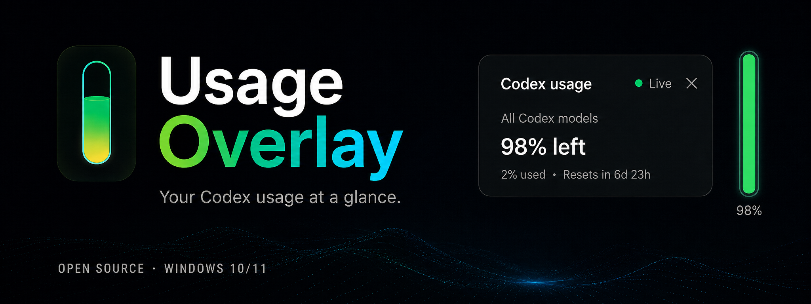
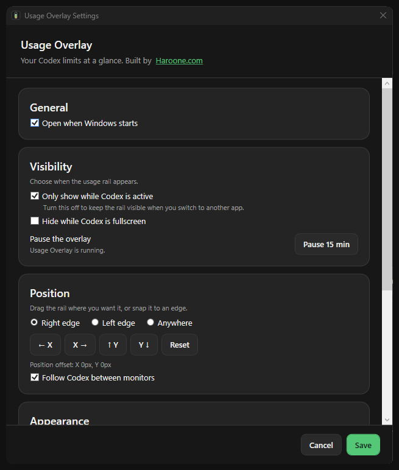

# Usage Overlay



**See how much AI usage you have left without leaving the app you're working in.**

Usage Overlay is a small, open-source Windows companion for AI coding apps. It places a slim usage rail beside **Codex**, **Claude** (the desktop app and Claude Code terminals) and **Cursor**, and opens a compact detail card when you need the numbers. The rail follows whichever app is in front, so you always see the limit that matters right now.

It runs as its own process. It does not modify these apps, inject code into them or read conversations. By default it never handles your credentials; the optional unofficial account sources described below read the sign-in Claude Code or Cursor saved on your PC.

Built by [Haroone.com](https://haroone.com).

> [!IMPORTANT]
> Usage Overlay is an independent preview project. It is not affiliated with or endorsed by OpenAI, Anthropic or Anysphere (Cursor).

## Supported apps

| App | Where the rail appears | Where the numbers come from | Setup |
| --- | --- | --- | --- |
| **Codex** | The Codex desktop app | The documented Codex App Server `account/rateLimits/*` methods, through the Codex CLI already signed in on your PC | On by default |
| **Claude** | The Claude desktop app, and any terminal or editor window running Claude Code | Your Pro or Max plan's 5-hour and weekly limits, which Claude Code passes to its status line. Optionally (unofficial) read from your Claude sign-in | Turn on **Claude** in Settings |
| **Cursor** *(experimental)* | The Cursor editor | Your plan usage from your Cursor sign-in (unofficial), or your spend from the official team Admin API | Turn on **Cursor** and choose a source |

Claude's plan limits are shared across Claude.ai, the desktop app and Claude Code, so one reading serves all of them. It refreshes whenever Claude Code replies; between replies the card shows how old the reading is.

### Unofficial account sources

Neither the Claude desktop app nor individual Cursor plans offer an official usage API. Two opt-in options fill that gap:

- **Read usage from my Claude sign-in:** uses the OAuth sign-in Claude Code saved in `~\.claude\.credentials.json` to call `https://api.anthropic.com/api/oauth/usage` every 5 minutes, the endpoint behind Claude's usage page. Use this if you mostly work in the Claude desktop app. Claude Code must have been signed in on this PC once.
- **Read usage from my Cursor sign-in:** reads the access token the Cursor editor saved in `%APPDATA%\Cursor\User\globalStorage\state.vscdb` (opened read-only) and calls the editor’s `https://api2.cursor.sh/aiserver.v1.DashboardService/GetCurrentPeriodUsage` endpoint every 5 minutes. The rail shows the allowance and reset time reported by the editor; the website’s separate monthly usage summary is not used because it can report an unused pool while the editor’s current allowance is partly spent.

Both are off by default. The tokens are only read when needed, sent only to their own service, and never stored, refreshed or logged by Usage Overlay. These endpoints are undocumented and may change or stop working. Anthropic's consumer terms also restrict how Claude sign-ins may be used, so turn the Claude option on only if you accept that risk.

## What it shows

The collapsed rail is designed to stay out of the way. Its fill and compact label show the amount remaining at a glance. Claude's rail shows the **5-hour limit** whenever it is available, with the weekly limit kept in the detail card. If Claude returns only a weekly limit, the rail uses that reading. Codex and Cursor keep their existing limit selection.

Hover over the rail to open the detail card. The card shows:

- Remaining or used percentage, depending on your preference
- The reset countdown for each limit window
- Live, connecting, stale or unavailable status
- Green, amber, or red status based on your configured thresholds
- **Other apps** (optional): the remaining usage of your other enabled apps. Click one to view it. Off by default, so the card shows only the app in front
- A small **View usage** link to the full usage page of the app shown

The tray icon's tooltip summarises every enabled app, for example `Codex 62% left · Claude 40% left`.

If an app has not returned a fresh limit yet, the rail shows `--`. The card says **Loading usage** while connecting and **Usage unavailable** if the limits cannot be read. It never presents an old Codex percentage as a current reading after the connection is lost; Claude and Cursor readings are labelled with their age.

## Features

- **Codex, Claude and Cursor in one rail:** the rail follows the app in front and shows only that app's usage.
- **Upgrade-safe integrations:** upgrades preserve existing Claude and Cursor opt-ins, including their saved-sign-in sources. Explicit choices made in the current Settings take precedence over legacy values. New installs keep both integrations off until enabled.
- **Official app icons:** the Codex and Cursor badges use assets from their official Windows applications.
- **Claude Code aware:** recognises terminals and editors (Windows Terminal, VS Code, Cursor and others) running Claude Code, and keeps your existing Claude Code status line working.
- **Remaining usage first:** the default view answers the useful question: how much do I have left?
- **Complete main-limit details:** inspect the primary and secondary usage windows for the main Codex limit without model-specific clutter.
- **Compact detail card:** hover to inspect the limit or click to keep the card open.
- **Reset countdown:** see when the current quota window resets.
- **Live updates:** listen for App Server updates and poll at a configurable interval as a fallback.
- **Three visual states:** green for normal usage, amber for warning, and red for critical.
- **Flexible placement:** use the right edge, left edge, position nudges, or drag the rail anywhere inside the app.
- **Monitor-aware positioning:** follow the app when it moves between monitors.
- **Visibility control:** show the overlay only with a supported app or keep it available across Windows.
- **Fullscreen control:** optionally hide the rail while the app is fullscreen.
- **Theme support:** follow the active app's light or dark surface, or force Light or Dark.
- **Reduced motion support:** turn animations off, with Windows reduced-motion settings respected automatically.
- **Native Settings window:** change behavior without editing configuration files.
- **System tray access:** reopen the rail, refresh usage, open Settings, view logs, or quit.
- **Optional low-usage alerts:** receive one Windows notification when any app's limit first turns amber or red.
- **Safe CLI updates:** disconnect and release the Codex CLI process before upgrading it, then reconnect without quitting the overlay.
- **Manual update checks:** check the official GitHub release from the rail or tray menu on demand.
- **Automatic startup:** optionally start Usage Overlay when Windows starts.
- **Single instance:** opening the app again talks to the running process instead of creating a duplicate.
- **Optional usage reporting:** off by default; share only a random installation ID and app version with Haroone to measure adoption. No advertising or remote account system.

Usage Overlay reads account state and limits through the officially documented [`account/read`, `account/updated`, `account/rateLimits/read`, and `account/rateLimits/updated`](https://developers.openai.com/codex/app-server) Codex App Server methods.

## Requirements

- Windows 10 or Windows 11 on x64

For each app you turn on:

- **Codex:** the Microsoft Store Codex desktop app, plus Codex Desktop or a separately installed Codex CLI on `PATH`, signed in with ChatGPT-backed authentication. API-key-only and Bedrock authentication do not provide account usage data.
- **Claude:** Claude Code signed in with a Claude.ai Pro or Max plan. The rail also appears beside the Claude desktop app. API-key and cloud-provider sign-ins don't report plan limits.
- **Cursor:** a Cursor team plan and a team Admin API key.

## Install

### Download a release

1. Open the repository's **Releases** page.
2. Download `usage-overlay-vX.Y.Z-win-x64-setup.exe`.
3. Run the installer, then launch **Usage Overlay** from Windows Search.
4. Focus the Codex desktop app. The rail will appear at its saved position. To add Claude or Cursor, open Settings and turn them on under **Apps**.

The app is not code-signed yet. Windows SmartScreen may show a warning on first launch. Review the published SHA-256 checksum before running the file.

The installer is per-user, does not require administrator access, and registers Usage Overlay in **Settings → Apps → Installed apps**. A portable zip remains available for users who prefer not to install the app.

### Portable version

Download `usage-overlay-vX.Y.Z-win-x64.zip`, extract the full archive to a directory you control, and run `UsageOverlay.exe`. Portable copies are removed manually and do not appear in Windows Installed apps.

### Add Windows shortcuts

The release includes optional PowerShell helpers:

```powershell
.\scripts\install-start-menu.ps1
.\scripts\install-startup.ps1
```

The Start-menu shortcut opens Settings. The startup shortcut launches the overlay quietly when you sign in to Windows.

Remove either shortcut without touching the application files:

```powershell
.\scripts\uninstall-start-menu.ps1
.\scripts\uninstall-startup.ps1
```

## Using the overlay

| Action | Result |
| --- | --- |
| Hover over the rail | Temporarily opens usage details |
| Move the pointer away | Closes an unpinned detail card |
| Click the rail | Pins or unpins usage details |
| Click the card's close button | Closes only the detail card |
| Press `Escape` | Closes pinned details without stopping the app |
| Drag the rail | Saves a custom position |
| Right-click the rail | Opens visibility, Settings, refresh, CLI connection, update, and quit actions |
| Click an app under **Other apps** | Shows that app's usage until a different app comes to the front |
| Double-click the tray icon | Restores a manually hidden rail |
| Open Usage Overlay from Windows Search | Opens the native Settings window |
| Launch the executable again | Restores the existing instance; no duplicate is created |
| Disconnect Codex CLI | Releases the CLI process so the npm-installed CLI can be updated safely |
| Check for updates | Checks the public GitHub Releases API for a newer stable version |

Choosing **Hide usage rail** does not stop usage updates. Use the tray icon to show it again. Choose **Quit Usage Overlay** when you want to stop the process.

## Settings

Open Settings from **Open settings…** in the rail or tray menu. Opening **Usage Overlay** from Windows Search also goes straight to this window.



### Saving and closing

Most controls are staged while the window is open. Choose **Save** or press `Ctrl+S` to validate and write them to `%LOCALAPPDATA%\UsageOverlay\settings.json`.

- **Save:** applies valid changes and keeps the Settings window open. A confirmation appears beside the buttons.
- **Cancel:** closes Settings and discards changes made since the last save.
- **Escape:** works like Cancel.
- **Minus button:** hides only the Settings window. The rail and tray process keep running, and unsaved fields remain available when you reopen Settings.
- **Close button:** closes Settings, discards unsaved changes, and does not quit Usage Overlay.

Theme choices are previewed immediately so you can compare them. Cancel, Escape, or the close button restores the last saved theme.

Save is blocked when:

- The amber or red threshold is not a number
- A threshold is outside `0–100`
- The amber threshold is equal to or higher than the red threshold
- The refresh interval is outside `15–3600` seconds
- A custom Codex CLI path does not point to an existing file

The validation message appears at the bottom of the window and moves focus to the field that needs attention.

### General

- **Open when Windows starts:** adds or removes a shortcut in your Windows Startup folder. This is a user-level setting and does not install a service.

### Apps

- **Codex:** reads limits through the Codex CLI. On by default.
- **Claude:** connects Claude Code's status line so Usage Overlay can record your plan limits. Saving with Claude on updates `~/.claude/settings.json` (or `CLAUDE_CONFIG_DIR`). If you already have a status-line command, it keeps running and keeps its output, and Usage Overlay records the limits silently alongside it. If you don't, Claude Code's status line shows a compact `5h 58% left · 7d 81% left`. Turning Claude off, or uninstalling Usage Overlay, restores your previous status line. If you changed the status line yourself in the meantime, yours is left alone.
- **Cursor (experimental):** enter the email of your Cursor account and a team **Admin API key**. The key is encrypted for your Windows account with DPAPI and stored separately from settings. Usage Overlay reads the matching member's spend every 15 minutes. With a spend limit set, the rail shows the share used; without one, the card shows the amount spent.

### Visibility

- **Only in these apps:** shows the rail while Codex, Claude, Cursor or a Claude Code window is active, and hides it when you switch away. This is the default.
- **Across Windows:** keeps the rail at its last position when you switch to another application.
- **Hide while the app is fullscreen:** removes the rail only while the active app's window fills its monitor.
- **Pause 15 min:** stages a 15-minute pause. Save to start the pause. Reopen Settings and choose **Resume now** to end it early.

Pausing or hiding the rail does not disconnect App Server. Usage can continue updating in the background.

### Position

- **Right edge:** anchors the rail to the right side of the tracked window.
- **Left edge:** anchors it to the left side.
- **Anywhere:** uses the custom position saved when you drag the rail.
- **X and Y buttons:** move the selected position 20 pixels with each click. The current offset is shown below the buttons.
- **Reset:** selects the right edge and returns both offsets to zero.
- **Follow the app between monitors:** moves the overlay with the app instead of keeping it on the monitor where the position was first established.

Custom positions are stored as relative coordinates, so the rail remains inside the app window after resizing or changing monitors.

### Appearance

- **Theme:** choose **Follow app**, **Dark**, or **Light**.
- **Main number:** choose **Left** to lead with remaining usage or **Used** to lead with consumed usage.
- **Turn amber at:** set the used percentage where the rail changes from green to amber.
- **Turn red at:** set the higher used percentage where the rail changes to red.
- **Animate changes:** smoothly moves the rail when a fresh value arrives. Windows reduced-motion preferences are still respected.
- **Show the percentage below the rail:** keeps the compact number visible while the detail card is closed.
- **List my other apps in the detail card:** adds an **Other apps** section with your other enabled apps. Off by default.
- **Notify me when usage turns amber or red:** sends one Windows notification when a returned limit crosses either configured threshold. Notifications are off by default.

**Follow app** checks a few background pixels from the active app window to decide whether the surface is light or dark. It does not capture, save, or log screen content. Windows appearance is used as a fallback when no supported app is in front.

### Connection and diagnostics

- This section is collapsed by default because most users do not need it.
- **Codex CLI path:** optionally point directly to `codex.cmd` or `codex.exe` when the command is not available on `PATH`.
- **Refresh every:** sets the fallback polling interval from 15 to 3,600 seconds. Live notifications can still update the rail sooner.
- **Open logs:** opens the local redacted diagnostic log.
- **Disconnect Codex CLI:** available from the rail and tray menus when you need to upgrade the npm-installed CLI. Choose Reconnect Codex CLI afterward.
- **Check for updates:** manually checks the public GitHub release. Usage Overlay does not check automatically.
- **Restore defaults:** stages the original settings. Choose Save to keep them.

CLI path and refresh interval changes take effect after the app restarts.

### Default settings

| Setting | Default |
| --- | --- |
| Start with Windows | Off |
| Codex | On |
| Claude | Off |
| Cursor | Off |
| Visibility | Only in these apps |
| Hide in fullscreen | Off |
| Position | Right edge |
| Follow the app between monitors | On |
| Theme | Follow app |
| Main number | Left |
| Amber threshold | 70% used |
| Red threshold | 90% used |
| Animate changes | On |
| Percentage below rail | On |
| Other apps in the card | Off |
| Threshold notifications | Off |
| Custom CLI path | Empty; use `PATH` |
| Refresh interval | 60 seconds |

## Connection states

| State | What it means |
| --- | --- |
| `Connecting…` | The app is starting Codex App Server and waiting for a fresh limit. |
| `Live` | A current limit was received and updates are active. |
| `Couldn’t connect` | Codex returned an error. The app keeps trying. |
| `Trying again…` | App Server stopped or failed and will be restarted. |
| `CLI not found` | Set the Codex CLI path in Settings or add it to `PATH`. |
| `Disconnected` | Usage Overlay has released its App Server child process for a CLI update. Choose Reconnect Codex CLI when finished. |
| `Waiting` | Claude is connected, but Claude Code hasn't run its status line yet. Send a message in Claude Code. |
| `No plan limits` | Claude Code runs the status line but sends no plan limits. Update Claude Code and check `/status` shows a Pro or Max plan. |
| `Updated 5m ago` | A Claude or Cursor reading and its age. Claude readings older than 15 minutes turn amber. |
| `Key rejected` | Cursor didn't accept the Admin API key. |

When no current limit is available, the rail remains neutral and shows `--` instead of a percentage.

## How it works

### Codex

Usage Overlay starts:

```text
codex app-server --stdio
```

It communicates with App Server through newline-delimited JSON-RPC:

1. Start and initialize App Server.
2. Request current limits with `account/rateLimits/read`.
3. Listen for `account/rateLimits/updated` notifications.
4. Poll periodically as a fallback.
5. Normalize the response and calculate remaining usage as `100 - usedPercent`.
6. Update the WPF rail and detail card on the desktop.

The overlay identifies the active Microsoft Store Codex window by its package process path. Its WPF window is topmost and non-activating, so pointer controls work without taking keyboard focus from the app.

### Claude

Claude Code passes session details to its status-line command on every update, including `rate_limits.five_hour` and `rate_limits.seven_day` for Pro and Max plans. When Claude is on, the status-line command runs `UsageOverlay.exe --claude-statusline`. That short-lived process:

1. Reads the status-line JSON from standard input and keeps only the two limit percentages and reset times.
2. Records the Claude Code process and its parent windows, up to but not including the Windows shell, so the rail can recognise the terminal or editor hosting Claude Code.
3. Writes `%LOCALAPPDATA%\UsageOverlay\claude-usage.json` and exits.

The overlay watches that file. A terminal stops counting as a Claude Code host when its Claude Code process exits.

### Cursor

Every 15 minutes, or when you choose **Refresh usage** (at most once a minute), Usage Overlay sends `POST https://api.cursor.com/teams/spend` with your email as the search term and the Admin API key as Basic authentication. It reads the matching member's on-demand spend, spend limit and billing-cycle start.

See [Architecture](docs/architecture.md) for the component map, data flow, Windows behavior, and failure handling.

## Privacy

For Codex, Usage Overlay requests only rate-limit metadata:

- Used percentage
- Window duration
- Reset timestamp
- Limit identifier and display name
- Plan type when returned

It does not request prompts, responses, conversation history, repository files, browser activity, cookies, passwords, API keys, or Codex authentication files.

For Claude, the status-line relay keeps only plan-limit percentages, reset times, the session ID and process IDs. It discards the rest of the status-line input, such as the working directory, model and transcript path, without storing it. For Cursor, the Admin API key you enter is sent only to `api.cursor.com` and stored only in DPAPI-encrypted form.

Codex CLI owns authentication and all account-data network access. Usage Overlay makes an HTTPS request to GitHub only when you explicitly choose **Check for updates**. Separately, optional installation reporting is off by default. Enable **Share optional installation and activity reports** in Settings and select Save to send a random installation ID and app version to `https://haroone.com/api/usage-overlay.php`, at most once per UTC day while the app runs. Disable it and Save to cancel pending requests and stop future reporting. No account, quota, conversation, credentials or logs are included. Previously received reports expire under the retention policy.

Read the full [Privacy policy](docs/privacy.md) and [Security policy](SECURITY.md) before sharing logs or reporting a vulnerability.

## Local files

Usage Overlay stores settings and logs on your computer. Opting in also creates `reporting.json`, containing a random installation ID and the last attempted reporting date:

```text
%LOCALAPPDATA%\UsageOverlay\settings.json
%LOCALAPPDATA%\UsageOverlay\overlay.log
%LOCALAPPDATA%\UsageOverlay\claude-usage.json        (Claude on)
%LOCALAPPDATA%\UsageOverlay\claude-statusline.json   (Claude on: restore point for your status line)
%LOCALAPPDATA%\UsageOverlay\cursor-admin-key.bin     (Cursor key saved: DPAPI-encrypted)
```

`settings.json` contains display preferences and your Cursor email. `overlay.log` contains redacted and truncated connection messages. None of these files is uploaded by the app.

Older settings from `%LOCALAPPDATA%\QuotaRail` or `%LOCALAPPDATA%\CodexUsageOverlay` are imported once when no current settings file exists. The old files are left unchanged.

## Troubleshooting

### The rail does not appear

- Make sure the app is open, visible, focused, and turned on under **Apps** in Settings.
- Open Usage Overlay again from Windows Search to restore a hidden instance.
- Check **Visibility** in Settings. Choose **Across Windows** if you want the rail outside the supported apps too.
- Check whether the overlay is paused or hidden during fullscreen.
- Right-click the system-tray icon and choose **Show usage rail**.

### The card says `CLI not found`

Run this in PowerShell:

```powershell
codex --version
```

Usage Overlay automatically prefers the CLI bundled with Codex Desktop. If neither that executable nor a working command on `PATH` is available, install Codex CLI or provide its full path under **Settings > Connection and diagnostics**.

### The card says `Usage unavailable`

- Confirm that Codex CLI is signed in with ChatGPT-backed authentication.
- Choose **Refresh usage** from the rail or tray menu.
- Open the diagnostic log from Settings.
- Restart Usage Overlay after changing the CLI path.

The app retries connection failures automatically. It also refreshes account state after Codex sign-in, sign-out, or account switching without reading authentication files.

### Claude shows `Waiting`

- Send a message in Claude Code. Limits arrive with its next reply.
- Check that Claude Code is signed in with a Pro or Max plan (`/status` in Claude Code). API-key sign-ins don't report plan limits.
- Make sure nothing else rewrote the status line in `~/.claude/settings.json`. Turn Claude off and on in Settings to reconnect.

### The Claude rail doesn't appear beside my terminal

The terminal is recognised after Claude Code updates its status line in that window. Send a message, then focus the window again. The Claude desktop app is recognised without this step.

### Cursor says `Not found` or `Key rejected`

- Enter the same email that your Cursor team shows for your account.
- Ask a team admin to confirm the Admin API key is active. Individual Cursor plans can't create one.

### The overlay uses the wrong theme

- Select **Follow app** and focus the app window once after changing its appearance.
- Choose **Light** or **Dark** for a fixed theme.
- If no supported app is in front, Follow app falls back to the Windows application theme.

### The position is wrong after changing monitors

- Enable **Follow the app between monitors**.
- Choose a left or right preset.
- Use **Reset** before saving a new custom position.

## Build from source

Install the [.NET 8 SDK](https://dotnet.microsoft.com/download/dotnet/8.0), then run:

```powershell
git clone https://github.com/haroonsulahri/usage-overlay.git
cd usage-overlay
.\scripts\build.ps1
.\scripts\run.ps1
```

The solution has two main projects:

- `CodexUsage.Core`: provider model, Codex, Claude and Cursor parsing, calculations, settings, reset formatting, and log redaction.
- `UsageOverlay`: WPF interface, usage providers, the Claude Code status-line relay, window tracking, shortcuts, and Windows integration.

## Demo mode

Demo mode renders the UI with sample Codex, Claude and Cursor usage, without connecting to any of them:

```powershell
dotnet run --project .\src\UsageOverlay\UsageOverlay.csproj `
    --configuration Release -- --demo=75 --expanded
```

Useful states:

| Value | Expected result |
| --- | --- |
| `--demo=25` | Green rail, 75% left |
| `--demo=75` | Amber rail, 25% left, plus the weekly detail row |
| `--demo=92` | Red rail, 8% left |

Open the Settings window directly:

```powershell
dotnet run --project .\src\UsageOverlay\UsageOverlay.csproj `
    --configuration Release -- --demo=75 --settings
```

Other launch options:

| Option | Purpose |
| --- | --- |
| `--expanded` | Opens the detail card on launch |
| `--start-hidden` | Starts with the usage rail manually hidden |
| `--settings` | Opens Settings on launch |
| `--provider=claude` | With `--demo`, shows Claude (or `codex`, `cursor`) first |

## Tests

Run the local quality gate:

```powershell
.\scripts\build.ps1
```

This restores and builds the Release configuration with warnings treated as errors, verifies the multi-size Windows icon, and runs the dependency-free specification suite.

Run the authenticated smoke test only on a machine already signed in to Codex:

```powershell
.\scripts\smoke-live.ps1
```

The smoke test starts App Server, waits for a real rate-limit snapshot, reports the remaining and used percentages, and closes its child process.

The complete manual acceptance matrix is in [Testing](docs/testing.md).

## Create a release

Build the self-contained Windows x64 package:

```powershell
.\scripts\package-release.ps1
.\scripts\validate-release.ps1
```

Release files are written under `artifacts\release` and excluded from Git. The zip contains the executable, licence, documentation, icon assets, and shortcut helpers. The release directory also contains the manifest and SHA-256 checksum.

Pushing a semantic version tag such as `v0.1.0` runs the GitHub release workflow and uploads the generated Windows package.

## Uninstall

### Installed version

1. Quit Usage Overlay from the rail or tray menu.
2. Open **Windows Settings → Apps → Installed apps**.
3. Find **Usage Overlay**, open its menu, and choose **Uninstall**.
4. Optionally delete `%LOCALAPPDATA%\UsageOverlay` to remove saved settings and logs.

The uninstaller removes the application and its Start Menu and startup shortcuts, and restores your previous Claude Code status line if Claude was on. It preserves settings and logs so an upgrade or reinstall can reuse them.

### Portable version

1. Turn off **Claude** in Settings and select Save, so your previous Claude Code status line is restored. Then quit Usage Overlay from the rail or tray menu.
2. Run the two `uninstall-*.ps1` shortcut scripts if you installed the shortcuts.
3. Delete the extracted application directory.
4. Optionally delete `%LOCALAPPDATA%\UsageOverlay` to remove saved settings and logs.

Usage Overlay does not install a Windows service, browser extension, driver, or background updater.

## Limitations

- Changes to the timestamps and size of `CODEX_HOME/auth.json` (or the default user `.codex` directory) are checked every two seconds. The overlay clears displayed usage and reconnects its own Codex process after a change, normally within about seven seconds plus the usage request time. It never reads or writes credential contents. File changes that preserve all monitored metadata cannot be detected by this check.
- When the credential file is absent or inaccessible, the overlay renews its connection every minute to reload credential-manager state. A login stored only inside another application's process cannot be detected through this mechanism.
- A revoked refresh token still requires signing into Codex again. After that login is saved, the overlay reconnects automatically. Network failures cannot provide fresh usage.

- Windows x64 only for this preview.
- Designed for the Microsoft Store Codex desktop package.
- Claude readings refresh only when Claude Code replies, so usage from Claude.ai or the desktop app appears after your next Claude Code reply.
- Claude Code status lines run through bash, as they do in Claude Code on Windows.
- Cursor support is experimental. It depends on Cursor's team Admin API, whose response includes fields beyond its public documentation.
- Uses the Codex Desktop bundled CLI when available; otherwise requires a separately installed CLI.
- Usage is near-real-time, not token-by-token.
- The executable is not code-signed yet, so SmartScreen may warn on first launch.
- Follow app infers light or dark from the rendered window because these desktop apps do not expose a public theme integration for companion tools.
- Usage Overlay is a separate companion window because these apps do not provide a public permanent desktop-chrome extension point.

## Contributing

Focused bug reports and pull requests are welcome. Please read [Contributing](CONTRIBUTING.md), the [Code of Conduct](CODE_OF_CONDUCT.md), and [Support](SUPPORT.md) before opening an issue.

Do not include credentials, account identifiers, private conversations, unreviewed logs, or private screenshots in public issues.

## About Haroone.com

Usage Overlay is built and maintained by [Haroone.com](https://haroone.com), a founder-led Magento and eCommerce engineering studio. Haroone works on custom modules, storefronts, integrations, migrations, performance, and technical SEO, alongside practical open-source tools like this one.

Usage Overlay is independently developed and is not affiliated with or endorsed by OpenAI, Anthropic or Anysphere.

## Licence

Usage Overlay is released under the [MIT Licence](LICENSE).

Codex, OpenAI, Claude, Anthropic and Cursor are referenced only to describe compatibility.
